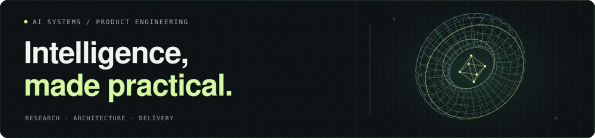

# Beefboy35

**AI Systems Architect · Senior Backend Engineer · R&D**

CTO at **[StudyNinja](https://studyninja.ru)**. I design and ship AI products end-to-end: system architecture, backend, low-level ML and LLM integration. My focus is where agents, knowledge graphs and real workflows meet — and where correctness, provenance and auditability actually matter.

4+ years building backend and AI systems. Led a team of 10 (6 engineers) across five AI product directions. Previously: search and machine learning at **Lamoda** and **OzonTech**.

---

## What I actually build

| Layer | What I do |
| :--- | :--- |
| **Architecture** | Service boundaries, data models, multi-tenant SaaS, event-driven backend, state machines with server-side transition validation. |
| **Knowledge & retrieval** | Typed weighted knowledge graphs (Neo4j/Cypher), hybrid retrieval (Qdrant + graph + user context), RAG pipelines with separated retrieval / context assembly / generation. |
| **LLM engineering** | Provider adapters (OpenAI, OpenRouter), prompt templates, token accounting, fallback, A/B and canary checks. Human-in-the-loop by default. |
| **Low-level ML** | Custom neural architectures in PyTorch: multi-branch encoders, multi-task heads, focal loss for long-tail, ablation-driven hyperparameter selection. |
| **Go/Python** | Native inference for lightweight models, gRPC instead of JSON-over-HTTP, circuit breakers and backpressure where Python hits GIL and unstable p99. |
| **Delivery** | CI/CD, Prometheus/Grafana, Sentry, Kubernetes, idempotent async tasks, audit trails. |

---

## Selected work

**[StudyNinja ↗](https://studyninja.ru)** · Adaptive education  
AI tutor that connects diagnostics, knowledge gaps and focused practice into a personal learning path. Typed knowledge graph on Neo4j + RAG on Qdrant + per-student context. Graph structure is separated from student state so the curriculum can evolve without recomputing every route.

**KnowledgeBaseAI** · Knowledge infrastructure  
Headless graph platform for connected knowledge, intelligent retrieval and agent memory. Designed as a domain service that other products consume — not a monolith.

**A bunch of AI products for clients** ·
MLM analytics with NLP-to-SQL and graph-assisted schema hints. BPM for procurement with deterministic pricing and AI-drafted proposals. Commerce intelligence with multi-tenant isolation, RLS and a financial-semantics invariant: *missing cost → NULL profit*, never a synthetic estimate.

<b>RAG + LLM harness · AI tutor context pipeline</b>

The tutor had to answer at the right level for a specific student — not just retrieve by semantic similarity.

- **Qdrant** vector search over chunked materials with metadata (topic, skill, difficulty).
- Graph-aware filtering: if the question is about topic X, context includes X and its prerequisites — not adjacent topics that confuse the model.
- Per-student context: mastered topics, diagnosed gaps, typical errors.
- **Separated services** on FastAPI + Kafka: retrieval scales independently from generation; swapping providers doesn't touch retrieval; context assembly is a transparent point where you can see exactly what goes into the model.
- **LLM harness:** OpenAI/OpenRouter adapters, prompt templates, token accounting, fallback to a backup model, A/B and canary support.

Hardest part wasn't the plumbing — it was the relevance/level tradeoff. Too much context and the model goes generic; too little and it can't answer precisely.

<b>Research · MAGIC, CognitiveScientificGraphAI & spiking neural networks</b>

**MAGIC / MagicWorld** explores human–AI collaboration through shared memory, connected knowledge and cooperating agents.

**[CognitiveScientificGraphAI ↗](https://github.com/Beefboy35/CognitiveScientificGraphAI)** turns scientific papers into a weighted graph of claims and evidence. Hybrid search, answers linked to sources and interactive 3D exploration make connections, contradictions and limitations visible.

**Spiking neural networks & neuroevolution (R&D)** — associative memory that reconstructs patterns from partial cues without falling back to text storage. LIF neurons, sparse 3D topology, STDP, homeostasis.

---

## Stack

**Build:** Python · FastAPI · Django · Go · TypeScript · React  
**Data:** PostgreSQL · ClickHouse · Redis · MongoDB · Neo4j (Cypher) · Qdrant · Elasticsearch  
**Streams:** Kafka · RabbitMQ · ARQ · NSQ  
**AI / ML:** PyTorch · RAG · OpenAI · OpenRouter · LangGraph · ONNX   
**Ship:** Docker · Kubernetes · gRPC · Traefik · GitHub Actions · Prometheus · Grafana · Kibana · Sentry · n8n

---

## How I work

I turn the problem into a clear scope, test the riskiest assumptions early, and keep architecture, product decisions and implementation connected. I prefer a boring, verifiable solution over a clever one — and I'd rather return "I don't know" than a confident wrong number.

---

**Have an AI product or a process to improve?**  
[Tell me what you’re building →](https://t.me/RealBeefBoy) · [Email](mailto:a.fokin1@yandex.com)
